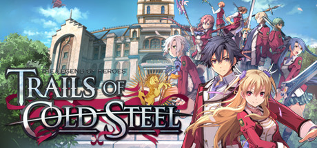

**Trails of Cold Steel follows noble military academy student Rean Schwarzer leading Class VII in a politically divided Erebonian Empire. Features the deep ARCUS Link system for bonding with classmates to unlock powerful combat abilities.**

---

## 📖 About

Trails of Cold Steel follows noble military academy student Rean Schwarzer leading Class VII in a politically divided Erebonian Empire. Features the deep ARCUS Link system for bonding with classmates to unlock powerful combat abilities.

## ⚠️ Problems Without Trainer

| Problem | Status |
|---------|--------|
| **Bonding Event Management** — Limited bonding points per chapter force choosing which links to develop | ✅ Solved |
| **Combat Arts** — Optimizing quartz setups for all characters requires deep system knowledge | ✅ Solved |
| **Late Game Difficulty** — Final dungeon encounters are significantly harder than mid-game | ✅ Solved |
| **Series Continuity** — References to Sky and Crossbell games create confusion for new players | ✅ Solved |

## ✅ Solution

The **The Legend of Heroes: Trails of Cold Steel Trainer** solves all these issues by giving you complete control over the game.

## 🎯 Full Feature List

- Unlimited Resources
- God Mode / Invincibility
- Instant Skill Cooldown
- One-Hit Kill
- Freeze Game Timer
- Unlock All Items & Achievements
- Custom Speed Multiplier
- Save State Anywhere

## 🚀 Quick Start

1. **Disable Windows Defender** temporarily (trainer may trigger false positive)
2. Download the trainer from the button above
3. Launch The Legend of Heroes: Trails of Cold Steel
4. Run the trainer as Administrator
5. Activate desired cheats with hotkeys

## 💎 Free vs Paid

| Feature | Free | Pro |
|---------|------|-----|
| Basic God Mode | ✅ | ✅ |
| Unlimited Resources | ✅ | ✅ |
| All Advanced Cheats | ❌ | ✅ |
| Auto-Updates | ❌ | ✅ |
| Priority Support | ❌ | ✅ |

## 💻 Requirements

- Windows 10/11 (64-bit)
- The Legend of Heroes: Trails of Cold Steel (any version)
- .NET Framework 4.8+
- DirectX 11+

## 🍎 macOS

macOS users can use our alternative tool:

## ⚖️ Legal

This trainer is for educational and single-player use only. Use responsibly.

---

